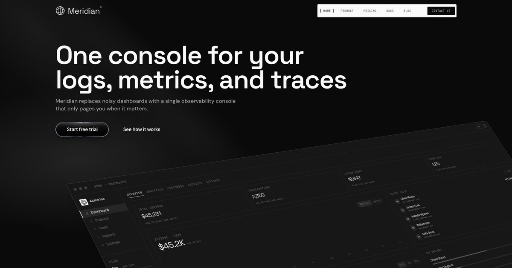

# Meridian Astro Template

Meridian Astro Template is a premium template built by https://www.shadcnblocks.com

- [Demo](https://meridian-astro-template.vercel.app/)
- [Documentation](https://www.shadcnblocks.com/docs/templates/getting-started)

## Screenshot



## Getting Started

```bash
npm install
```

```bash
npm run dev
```

Open [http://localhost:4321](http://localhost:4321) with your browser to see the result.

## Tech Stack

- Astro 6
- React 19 (for interactive islands)
- Tailwind 4
- shadcn/ui (composed via the `radix-ui` mono package)
- Motion / GSAP
- MDX content collections (dispatches, docs, legal)
- Shiki (server-rendered syntax highlighting)

## Deploy

You can deploy this template to your preferred hosting platform that supports Astro applications.

We have tested this template with the following providers using static export.

- [Netlify](https://netlify.com)
- [Vercel](https://vercel.com)
- [Cloudflare Pages](https://pages.cloudflare.com)

## Intro Animation

The template plays a short intro that cycles "Observe. Measure. Respond." and
morphs into the Meridian brand mark in the navbar
(`src/components/layout/loaders/intro-loader.tsx`).

**When it plays.**

- **Home (`/`)** — always plays on a direct load or refresh.
- **Any other page** — plays only on the first direct visit. Once it
  completes, a year-long cookie (`meridian-intro-seen`) is written and
  subsequent refreshes or direct visits to non-home pages skip it.
- **SPA-style anchor navigation** within the same tab never replays the intro;
  the loader mounts once per browser tab and decides what to do based on the
  initial pathname.

**Disabling it.** Set `enabled: false` in `src/lib/constants.ts`:

```ts
export const INTRO_ANIMATION = {
  enabled: false,
  cookieName: "meridian-intro-seen",
} as const;
```

With `enabled: false` the loader skips straight to the "done" phase on every
load, the brand mark renders directly in the navbar, and no cookie is written.

To force the intro to replay on a non-home page during development, clear the
`meridian-intro-seen` cookie in your browser devtools (Application → Cookies).

## Content Collections

MDX content is organized into three Astro content collections, configured in
`src/content.config.ts`:

| Collection   | Path                      | Routes          |
| :----------- | :------------------------ | :-------------- |
| `dispatches` | `src/content/dispatches/` | `/blog/[slug]`  |
| `docs`       | `src/content/docs/`       | `/docs/[slug]`  |
| `legal`      | `src/content/legal/`      | `/legal/[slug]` |

Each collection has a Zod schema enforcing required frontmatter fields. Add a
new MDX file to the collection directory and a new static page is generated at
build time.

The docs MDX pipeline supports custom components — `Accordion`, `Cards`,
`Steps`, `Tabs`, `Callout`, `TypeTable`, `Files`, `Badge` — exported from
`src/components/mdx/mdx-components.tsx` and passed to `<Content components={…} />`
on the docs page.

## Search

The `⌘K` search dialog (`src/components/docs/docs-search.tsx`) reads a static
JSON index at `/api/search.json` (generated at build time from the `docs`
collection in `src/pages/api/search.json.ts`) and filters client-side. The
index ships with title, description, and group — adjust the endpoint if you
need to include heading-level snippets.
